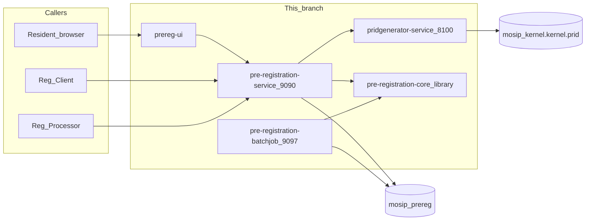

# Consolidating Pre-Registration into one HTTP service

This branch folds the three HTTP services on `develop` plus booking from [mosip-ref-impl issue-1633](https://github.com/mosip/mosip-ref-impl/tree/issue-1633/pre-registration-booking-service) into one JVM. Callers keep the same URLs. The batch Job stays its own process. PRID generation moved here from [mosip/commons](https://github.com/mosip/commons) as a **separate** Vert.x service (`pridgenerator-service`); it is not folded into the HTTP JVM. The Angular SPA lives in [`ui/`](../../ui/) (imported from [mosip/pre-registration-ui](https://github.com/mosip/pre-registration-ui) `develop`). Platform move (Boot 4.1.2 / Java 21 / Jakarta / Jackson 2): [spring-boot-4.md](spring-boot-4.md).

---

## What develop looked like

`develop` builds and deploys one process per domain. Each process has its own Maven module, image, port, and Helm chart.

| Service on `develop` | Maven module | Port | Public prefix |
|---|---|---|---|
| Application | `pre-registration-application-service` | 9090 | `/preregistration/v1` |
| Datasync | `pre-registration-datasync-service` | 9094 | `/preregistration/v1` (`/sync`, `/syncV2`, …) |
| Captcha | `pre-registration-captcha-service` | 9089 | `/preregistration/v1/captcha` |
| Batchjob | `pre-registration-batchjob` | 9097 | Job |
| PRID generator (commons) | `kernel-pridgenerator-service` | 8100 | `/v1/pridgenerator` |

`pre-registration-core` is a library, not a service.

Helm charts on `develop`: `prereg-application`, `prereg-datasync`, `prereg-captcha`, `prereg-batchjob`. PRID chart lived in commons: `helm/pridgenerator`.

---

## What this branch deploys

One HTTP process, `pre-registration-service`, listens on **9090**. Application, datasync, captcha, and booking run inside it. `pre-registration-core` stays a published library. `pre-registration-batchjob` stays its own module and is still installed as `helm/prereg-batchjob`. `pridgenerator-service` (renamed from commons `kernel-pridgenerator-service`) is moved into this reactor as its own JVM (port **8100**, prefix `/v1/pridgenerator`) and Helm chart `helm/pridgenerator`. The SPA is `helm/prereg-ui`.

```text
develop                              this branch
─────────────────────────            ─────────────────────────
application-service  :9090           pre-registration-service :9090
datasync-service     :9094             application + datasync
captcha-service      :9089             + captcha + booking
booking-service (ref-impl) :9095
batchjob Job         :9097           batchjob Job (unchanged)
pridgenerator (commons) :8100        pridgenerator-service :8100
pre-registration-ui (separate repo)  ui/ (this repo)
```

Maven reactor modules are `pre-registration-core`, `pre-registration-service`, `pre-registration-batchjob`, and `pridgenerator-service`. The Angular SPA is `ui/` (not a Maven module). Helm charts that remain are `helm/prereg-application` (the HTTP service), `helm/prereg-batchjob`, `helm/pridgenerator`, and `helm/prereg-ui`. `deploy/prereg/install.sh` installs application + batchjob + pridgenerator + UI.

---

## Approach

### 1. Move code, do not rewrite the APIs

Domain packages moved into `pre-registration-service` as they were:

* `io.mosip.preregistration.application` — demographic, document, login, notification, appointment proxy
* `io.mosip.preregistration.booking` — native `/appointment/**` (imported from mosip-ref-impl issue-1633 with git history)
* `io.mosip.preregistration.datasync` — forward and reverse sync
* `io.mosip.preregistration.captcha` — `validatecaptcha`

Controllers keep relative mappings. Servlet context is `/preregistration/v1`. Captcha used a dedicated context `/preregistration/v1/captcha`; `PreregApiPathConfig` adds `/captcha` on `CaptchaController`. Booking-native mappings are `/appointment/**` on that same servlet context (no extra prefix).

| Prefix | Controllers |
|---|---|
| `/preregistration/v1` (servlet context) | application, datasync, and booking-native `BookingController` (`/appointment/**`) |
| `/preregistration/v1/applications/appointment/**` | `AppointmentController` (application proxy over `InProcessBookingClient`) |
| `/preregistration/v1/captcha` | `CaptchaController` |

The Istio `VirtualService` on the application chart matches application, `/appointment`, `/sync`, `/captcha`, and swagger prefixes and sends them to this one Service.

### 2. In-process after merge

Cross-module calls go through `pipeline.InProcessBookingClient` / `InProcessApplicationClient` (`@Lazy` SDK adapters, same pattern as id-repository `InProcessCredentialClient`) — no internal HTTP to `/appointment/**`. `DataSyncServiceUtil` injects `DemographicServiceIntf`, `DocumentServiceIntf`, `ApplicationServiceIntf`, and `InProcessBookingClient`. `AppointmentUtil` and `NotificationService` call `InProcessBookingClient`. Booking looks up application status through `InProcessApplicationClient`. Login calls `CaptchaService` when `mosip.preregistration.captcha.enable=true`.

Datasync IAM client (`mosip-reg-client`) vs resident client: keep **role/path-based** security. Do not collapse to one Keycloak client.

### 3. Narrow component scan

`PreRegistrationBootApplication` imports `HttpModeScanConfiguration` instead of scanning `io.mosip.kernel` as a whole. The scan is `io.mosip.preregistration` plus the packages this JVM actually uses (auth adapter, transliteration, idobjectvalidator, virusscanner, khazana, analytics). Batchjob types stay out of the HTTP scan.

### 4. One config-server application, several property documents

`spring.application.name` is `pre-registration-service`. The process still imports the old documents:

```properties
spring.cloud.config.name=application,pre-registration
```

A key that appears in more than one of those documents has a single value in this JVM.

### 5. Deploy order

1. Database (`db_scripts` / `db_upgrade_scripts`).
2. `helm/prereg-application` — one Deployment, port 9090 (application + datasync + captcha + booking).
3. `helm/prereg-batchjob`.
4. `helm/pridgenerator` (Service `kernel-pridgenerator-service`, probes `/v1/pridgenerator/actuator/health`).
5. `helm/prereg-ui`.

`deploy/prereg/install.sh` runs those four charts. Probes use `/preregistration/v1/actuator/health`. The old health URLs on 9089, 9094, and 9095 are gone.

---

## What did not change

* REST paths listed above.
* `pre-registration-core` as the published library.
* `api-test` endpoint paths.
* Booking public prefixes: `/preregistration/v1/appointment/**` (native) and `/preregistration/v1/applications/appointment/**` (application proxy).
* Database `mosip_prereg`.
* PRID as a separate process and public prefix `/v1/pridgenerator`.
* Database `mosip_kernel`, table `kernel.prid` (not merged into `mosip_prereg`).

---

## Consequences

* **One failure domain.** A crash stops application, datasync, captcha, and booking together.
* **Shared resources.** One heap, one Tomcat pool, one auth filter.
* **Config collisions.** A property added for one old service can now override the shared default for every API in the process.
* **Gateway.** `/appointment`, `/sync`, and `/captcha` must route to the application Service.
* **Health.** Cluster probes belong on `/preregistration/v1/actuator/health` of the single pod.


